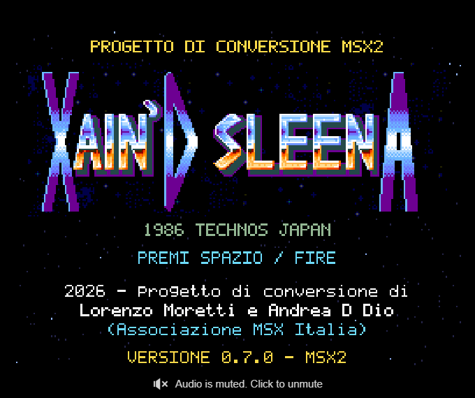
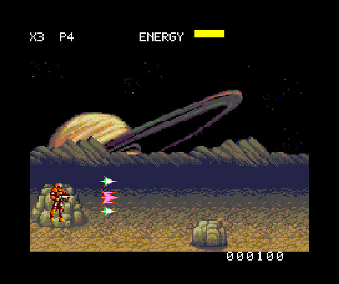

# Xain’d Sleena per MSX2

**2026 - progetto di conversione di Lorenzo Moretti e Andrea D Dio (Associazione MSX Italia)**

Versione **0.7.0** — progetto in sviluppo, con sorgenti Z80, ROM e avvio in WebMSX.

## Gioca online

**[Avvia il gioco nel browser](https://xain-msx2-italia.grandbuddy11.chatgpt.site)**

Non serve installare un emulatore. Clicca sullo schermo per attivare tastiera e audio; premi **Spazio** o Fire per iniziare e avanzare nell'intro. Nella pagina puoi scegliere la scheda audio e un'arma iniziale per il banco prova.



## Stato della conversione

Questa versione comprende titoli con logo originale, intro italiana, un settore tecnico giocabile, cinque famiglie d'arma, bonus P, posture, energia, vite e punteggio. Il progetto punta a una conversione fedele all'arcade; **non e ancora il port completo**.

Il fondale rimane ciclico e i nemici sono semplificati. Mancano percorsi e collisioni dei livelli originali, boss e mini-boss, scelta dei pianeti, conto alla rovescia e fuga, sezioni spaziali e nave madre. Anche animazioni, tempi delle armi e suoni richiedono ulteriore lavoro di fedelta.

## Contenuti della 0.7.0

- Grafica SCREEN 8 con 256 colori e sprite ricavati dall'arcade.
- Scrolling V9938 con 16 fasi R#18, doppia pagina e mascheratura dei bordi.
- Laser normale, laser con granate, Photon a due vie, laser pesante perforante e laser largo triplo.
- Portatori del bonus P, raccolta e perdita del potenziamento alla morte.
- Doppio salto, inginocchiamento e posizione prona.
- Tre vite, energia a 16 unita, punteggio a sei cifre e vite extra.
- Titolo, invito lampeggiante, tre schermate introduttive e ciclo automatico di presentazione.
- Trascrizione di sei voci FM dei 29 comandi musicali originali.



## Comandi

| Comando | Azione |
|---|---|
| Sinistra / destra | Movimento e direzione del tiro |
| Su | Salto; rilascia e premi nuovamente per il secondo salto |
| Giu | Inginocchiati; rilascia e premi nuovamente per sdraiarti |
| Spazio | Una salva per pressione |
| Joystick, pulsante 1 | Sparo / avvio |
| Joystick, pulsante 2 | Salto |

Le diagonali verso il basso cambiano la mira restando abbassati. Le direzioni laterali rialzano il personaggio. Dopo GAME OVER o SECTOR CLEAR, rilascia e premi Spazio per ricominciare.

L'HUD mostra **X** per le vite e **P** per il numero dell'arma. Si parte con il laser normale; le armi 1–4 si ottengono raccogliendo i pacchi P. Le altre armi iniziali nel menu del browser sono una funzione di prova.

## ROM e requisiti

Carica [xain-msx2.rom](xain-msx2.rom) come cartuccia **ASCII16 da 1 MiB** in un MSX2 con **128 KiB di VRAM**, V9938 e Z80 standard. Non richiede MSX2+. La ROM e stata verificata in WebMSX, in NTSC e PAL; hardware reale non ancora verificato.

Puoi anche scaricare il repository e aprire `index.html`: contiene la stessa ROM incorporata e usa il file locale `wmsx.js`.

## Audio

| Scheda | Stato |
|---|---|
| PSG | Tre voci, uscita verificata in WebMSX |
| SCC + PSG | Cinque voci, uscita verificata in WebMSX |
| MSX-MUSIC / FM-PAC + PSG | Sei voci YM2413; MSX-MUSIC verificato, abilitazione FM-PAC reale da verificare |
| MSX-AUDIO / Y8950 | Driver presente, uscita ancora da validare |
| OPL4 / MoonSound + PSG | Sei voci PCM YRW801, uscita verificata in WebMSX |

Nella ROM: F1 PSG, F2 SCC, F3 YM2413, F4 Y8950, F5 OPL4. La scheda deve essere presente nell'emulatore o nell'hardware; in sua assenza viene usato il PSG.

La musica e temporizzata dagli interrupt, indipendentemente dal rendering. Sono trascritte note, volumi e riattacchi delle sei voci FM; mancano le parti SSG/rumore e i timbri originali a quattro operatori. Le acquisizioni durano circa 62,6 secondi per comando e vengono ripetute come blocchi: i punti di loop originali non sono ancora identificati. Gli effetti sonori sono adattamenti PSG.

## Compilazione

I binari grafici e musicali generati sono inclusi. Per compilare servono **SjASMPlus 1.24.0** e Node.js, oppure PowerShell per lo script Windows.

```sh
node scripts/build.mjs /percorso/sjasmplus
```

Con `sjasmplus` nel PATH basta `node scripts/build.mjs`. La compilazione aggiorna la ROM e la copia incorporata in `index.html`.

Su Windows e disponibile anche:

```powershell
.\build.ps1 -Assembler C:\percorso\sjasmplus.exe
```

Solo per rigenerare grafica, HUD e titoli, installa la dipendenza `sharp` ed esegui:

```sh
npm install
npm run assets
node scripts/build.mjs /percorso/sjasmplus
```

La libreria musicale acquisita e gia inclusa in `src/audio/`.

## Verifiche e prestazioni

La 0.7.0 compila senza errori e avvisi. Sono stati verificati titoli, intro automatica e manuale, ritorno al gioco e crediti. La build 06 comprende tredici verifiche di armi, bonus, danni, vite, punteggio ed esplosioni, con fixture RAM per le condizioni limite.

Nello stress con nove grandi proiettili: tutte le fasi di scroll, nessuna scrittura R#18 fuori VBlank o con VDP occupato, zero differenze su oltre 35.000 pixel confrontati. La frequenza grafica dipende dal carico: nello stress artificiale e stata circa 12 aggiornamenti/s. Il target di gioco a 50/60 aggiornamenti/s non e ancora raggiunto; la musica mantiene il proprio clock.

Documentazione dettagliata: [titoli e intro](docs/BUILD07.md), [armi e meccaniche](docs/BUILD06.md), [audio](docs/BUILD05.md). I report JSON sono nella cartella `docs/`.

## Crediti e componenti di terze parti

Progetto di conversione: **Lorenzo Moretti e Andrea D Dio — Associazione MSX Italia, 2026**.

Gioco, grafica e composizioni originali: **Technos Japan, 1986**. WebMSX: **Paulo Augusto Peccin**. Layout e riferimenti tecnici: driver Xain di MAME. Dati degli strumenti OPL4 derivati dal driver Linux YRW801: avviso completo in [THIRD_PARTY-YRW801.txt](src/audio/THIRD_PARTY-YRW801.txt).

La pubblicazione del repository non attribuisce una licenza sui materiali originali del gioco. Gli avvisi dei componenti di terze parti sono conservati; non viene dichiarata una licenza unica per l'intero pacchetto.
