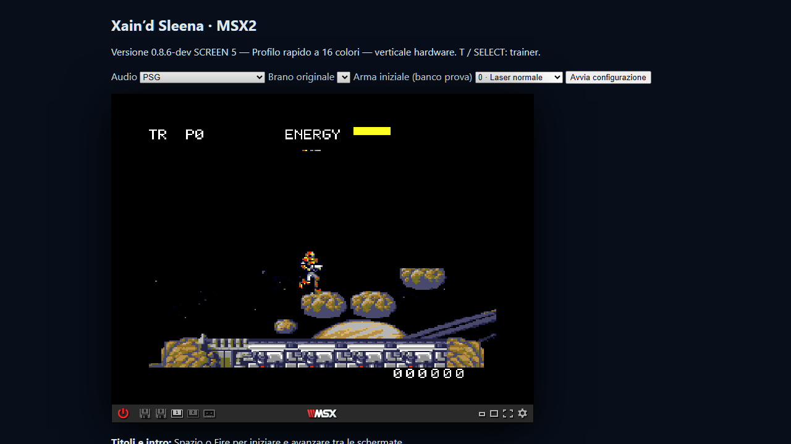

# Xain’d Sleena per MSX2 — 0.8.6-dev e 0.8.6C-dev

**2026 - progetto di conversione di Lorenzo Moretti e Andrea D Dio (Associazione MSX Italia)**

Aggiornamento del 17 novembre 2026. Conversione nativa per Z80, logica C compilata con SDCC e input Fusion-C; video e audio in assembly. Livelli e boss completi sono ancora in lavorazione.

## Scarica e prova

| ROM | Grafica | Scrolling |
| --- | --- | --- |
| [XAIN086.ROM](XAIN086.ROM) | SCREEN 5, 16 colori | Variante rapida: verticale hardware, protagonista a sprite hardware |
| [XAIN086C.ROM](XAIN086C.ROM) | SCREEN 8, 256 colori | Variante cromatica, compositore precedente più lento |

Entrambe sono cartucce **ASCII16 da 2 MiB** e richiedono MSX2 con **128 KiB VRAM**. Sul Pico+ selezionare esplicitamente ASCII16. In WebMSX caricare la ROM nello slot cartuccia e forzare lo stesso mapper. Non occorre MSX2+.

**Trainer: T oppure SELECT.** TR nell’HUD indica che è attivo: energia protetta, vite e arma conservate; cadendo nel vuoto si torna all’ultimo terreno sicuro. Premere di nuovo per disattivarlo. All’avvio è disattivato.

Frecce: movimento, Su salto/doppio salto, Giù posture. Spazio: avvio/sparo. Joystick: pulsante 1 sparo, pulsante 2 salto. Audio: F1 PSG, F2 SCC, F3 MSX-MUSIC, F4 MSX-AUDIO, F5 OPL4, con hardware corrispondente presente. Il collaudo audio su tutte le cartucce reali resta da completare.

## Cosa cambia

La 0.8.6 rapida usa R#23 per l’intera escursione verticale, a passi fino a due pixel, senza ricopiare il fondale. L’orizzontale combina R#18 e doppia pagina, distribuendo la composizione su otto lavori. Il protagonista viene disegnato con sprite hardware; interrupt di linea separano HUD e campo di gioco. Logica e musica usano il riferimento degli interrupt video.

Entrambe le varianti includono trainer, collisioni ottimizzate e cache per terreno dei nemici e punteggio. Sono presenti il primo percorso con collisioni, salita e rocce attraversabili, effetti di nube alla morte, armi e bonus; la fedeltà e i contenuti restano in sviluppo.

## Prestazioni e stato dei test

Benchmark isolato WebMSX PAL: circa **40 ms** per aggiornamento orizzontale/diagonale e **20 ms** verticale nella variante rapida, contro circa 58 ms e 80 ms della 0.8.5 nelle stesse condizioni. Non sono valori garantiti per tutte le scene: l’orizzontale non raggiunge ancora 50 Hz.

**50 controlli passati** sulla variante rapida e **58 sulla variante a 256 colori**, inclusi collisioni, armi e trainer. La nuova gestione SCREEN 5 deve ancora essere collaudata su NMS8245/Pico+ fisico. La conversione completa dei livelli, dei boss e delle sezioni spaziali non è terminata.

## Sorgenti e compilazione

- [Variante rapida SCREEN 5](native/xain-msx2-fast/README.md)
- [Variante SCREEN 8 a 256 colori](native/xain-msx2-fusionc/README.md)
- [Note e istruzioni delle ROM](XAIN086-NOTE.txt)

Servono Node.js, SDCC con assembler/linker Z80 e sjasmplus:

    cd native/xain-msx2-fast
    node build.cjs C:/strumenti/sdcc/bin/sdcc.exe C:/strumenti/sjasmplus.exe

Per la variante C usare la cartella native/xain-msx2-fusionc. Asset generati e avvisi delle terze parti sono inclusi. Il convertitore SCREEN 5 legge le risorse dalla cartella sorella SCREEN 8. Rapporti QA nelle rispettive cartelle; alcuni runner conservano percorsi del workspace di sviluppo da adattare alla propria macchina.

La demo [Sites](https://xain-msx2-italia.grandbuddy11.chatgpt.site/) e i sorgenti storici alla radice restano **0.7.0**: per le nuove versioni usare le ROM e le cartelle native indicate sopra. [Documentazione storica 0.7.0](docs/README-0.7.0.md).

Gioco, grafica e composizioni originali: Technos Japan. WebMSX: Paulo Augusto Peccin. Avvisi Fusion-C e YRW801 conservati nei sorgenti. Non è dichiarata una licenza unica sui materiali originali del gioco.
